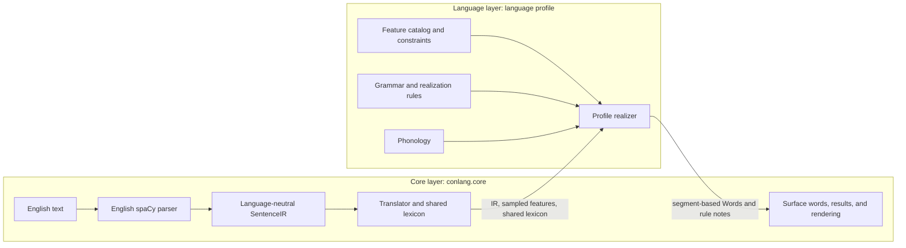

# conlang

`conlang` generates deterministic constructed-language text from English sentences. The current implementation has one registered profile, `austronesian`, at output version 2. Output is not a translation and has no back-translation, semantic-preservation, or translation-accuracy guarantee.

## Install

Python 3.10+ is required. Install the project and development dependencies, then install the pinned English model separately:

```bash
python -m venv .venv
source .venv/bin/activate
pip install -e ".[dev]"
python -m spacy download en_core_web_sm-3.8.0
```

If the spaCy downloader cannot resolve the pinned model for a newer Python runtime, install the same model wheel directly during setup:

```bash
python -m pip install https://github.com/explosion/spacy-models/releases/download/en_core_web_sm-3.8.0/en_core_web_sm-3.8.0-py3-none-any.whl
```

There is no network access at runtime. The test configuration checks for spaCy 3.8.x and `en_core_web_sm` 3.8.0; if they are missing or mismatched it reports the exact model-install command and skips model-dependent tests. Run tests with `pytest`.

## Development Checks

The `.[dev]` extra installs Ruff (linting and formatting), mypy (static typing), Vulture (high-confidence dead-code detection), pytest, and pytest-cov. From an activated environment:

```bash
make format       # apply Ruff formatting to project code and tests
make format-check # verify formatting without changing files
make lint         # Ruff lint and import checks
make typecheck    # mypy checks the conlang package; third-party stubs are skipped
make deadcode     # Vulture reports findings at 80% confidence or higher
make test         # full pytest suite
make coverage     # pytest with a terminal coverage report
make check        # formatting check, lint, typecheck, dead-code scan, and tests
```

### Nix

The flake provides Python 3, spaCy 3.8, the SHA-256-pinned `en_core_web_sm` 3.8.0 wheel and Python quality tooling:

```bash
nix develop
python -m pytest
python -m conlang.cli --seed 42 "The child saw two birds."
```

The model wheel is fetched and verified during Nix realization, not at application runtime.

## CLI

```bash
python -m conlang.cli --language austronesian --seed 42 "The child saw two birds."
python -m conlang.cli --seed 42 --gloss "Will you come home?"
python -m conlang.cli --seed 42 --set articles=both --set article_position=after "The dog runs."
python -m conlang.cli --seed 42 --uniform "A cup of tea is here."
python -m conlang.cli --seed 42 --describe
python -m conlang.cli --seed 42 --export-dialect
python -m conlang.cli --features
python -m conlang.cli --seed 42 --check "The door was opened by Mina."
python -m conlang.cli --seed 42 --lexicon "The dog runs."
python -m conlang.cli --list-languages
python -m conlang.cli --seed 42 --repl  # loads the parser once; :help lists commands (:gloss, :rules, ...)
python -m conlang.cli --seed 42 --verbose "Alice left and Bob ran tomorrow."
```

`--gloss` prints text, segmentation, and gloss lines, with blank lines between sentences. `--describe` prints the phoneme inventory, syllable probabilities, grammar settings, and function forms. `--features` lists option weights, attestations, statuses, source fields, and excluded features for the selected `--language` (default: `austronesian`). `--set FEATURE=OPTION` uses feature IDs and options from that same profile catalog; repeat it to fix multiple features. Incompatible assignments report their constraint IDs. `--uniform` ignores weights while preserving constraints. `--lexicon` emits stable-order JSON for words and morphemes actually used in this invocation. `--export-dialect` includes the seed, function forms, output version, and parser/model versions. `--check` reports IR audit status and lexical homophones.

Rule messages go to stderr as `[rule] ...`, each at most once per result, at one of two levels. Notices are shown by default and cover lossy or unexpected behavior (the true rootless fallback, unparsed numerals, a failed IR audit). Informational notes, such as the embedded-clause simplification note and `residual token: X`, are hidden unless you pass `--verbose` or, in the REPL, toggle them with `:rules` (like `:gloss`). Verbless input (bare noun phrases, numerals, interjections) is realized with the dialect's grammar and produces no fallback notices. Verbosity does not change stdout, `--check` output, or exit codes.

## Architecture

The system has two layers. The shared engine understands the IR and common word/result structures; a language profile supplies the choices and rules that turn that IR into language-specific forms. The parser is specifically an English input boundary, not part of the language-neutral IR or a general multilingual parser.



**Core layer (`conlang.core`)**

- Parses English and converts it to the language-neutral IR dataclasses. The spaCy dependency is confined to `core/parser.py`; the parser's English-specific analysis is distinct from the IR representation.
- Provides shared infrastructure: profile registry, generic feature sampling and constraint checks, IR auditing, seed derivation, lexicon, segment-based `Word`/`Morpheme` operations, result structures, surface handling, and text/segmented/gloss rendering.

**Language layer (profiles)**

- Defines the language's feature catalog and constraints, phonology, grammatical systems, and realization rules.
- Maps the IR's structural and meaning-bearing values to language-specific order and morphology, and uses the shared word and lexicon interfaces to build forms. `austronesian` is currently the only implemented profile; `_template` is a non-discovered starter skeleton.

**Interface and extension**

Core selects a registered profile, samples its catalog through the shared feature machinery, constructs its phonology and realizer, and passes the realizer an audited `SentenceIR` and the core-owned lexicon. The profile decides how its catalog and grammatical/phonological rules interpret that input. Its realizer returns segment-based words and rule notes; core applies the profile's surface validation, records lexical output, and creates results for rendering. Additional profiles can supply their own catalog, constraints, phonology, and realizer against these shared structures and register with the existing discovery mechanism; this is an extension point, not a claim that other profiles are implemented.

## Profile Derivability

Profile realization is designed to derive grammatical categories from information in the English-derived IR, rather than choosing a category with per-sentence randomness. When English does not determine a value, the parser uses `UNSPECIFIED`; profiles should map that value deterministically. A profile may merge or relabel distinctions represented in the IR, but should not add distinctions the IR does not provide. Seeded dialect features choose a profile's feature assignment and form variation; they do not fill in missing English information.

The core's `--check` audit checks whether IR fields read during realization are structural fields or are declared in the active meaning-bearing features' `source_fields`. It does not prove that a profile's mappings are complete or linguistically correct. Mapping completeness and behavior are responsibilities of each profile and its tests.

## English parsing

The parser converts tokens to plain IR dataclasses and retains source spelling, lemma, POS/tag, morphology, dependency, and head index. The derivation rules are:

- Voice is passive exactly when the root has an `nsubjpass` child.
- `will`, including `wo` in “won't”, gives future. Otherwise tense comes from a finite auxiliary or finite verb; participles, other modals, infinitives, and imperatives do not supply tense.
- Perfect is root `VBN` plus a `have` auxiliary. In the parsed perfect-progressive chain `have` + participial `be` + root `VBG`, both perfect and progressive are true. Progressive is root `VBG` plus a `be` auxiliary. The flags are independent.
- Interrogative mood is detected from final `?`, auxiliary/copular inversion, or a `WP`, `WRB`, or `WDT` token. Imperative mood requires bare `VB`, no subject or auxiliary, and no detected question; otherwise mood is declarative. Questions without detectable punctuation, inversion, or wh-words cannot reliably be identified.
- An expletive `there` (`expl`) makes the clause existential for any root, and the expletive is absorbed with reason `expletive`. For a `be` root otherwise, `attr` or `acomp` means equational; `prep` means locative; otherwise it is equational. Other roots are verbal. Transitivity is true for a direct/indirect object or passive voice.
- Argument roles follow `core/roles.py`: active transitive subject = agent; passive subject = patient; by-phrase = agent; everything else = other. spaCy `dative` is mapped to indirect object.
- Pronoun person/number/gender/case and noun number are read from morphology when available. Missing number, including “you”, is `UNSPECIFIED`. Personal, wh-, other, and demonstrative pronouns have separate NP kinds; missing person is never defaulted to third person.
- `NounPhrase.pos` and `Modifier.pos` preserve spaCy coarse POS. Definiteness comes only from `Definite=Def|Ind` morphology; articles are removed from modifiers. A common noun with no article, possessive determiner, or demonstrative is `UNSPECIFIED`; structurally inapplicable heads use `none`.
- Numeral values combine supported English cardinal words and chains, including hyphens, “and”, “a hundred”, and scales through millions. Digit-containing tokens remain exact literals; ordinal words remain ordinary lexical roots.
- Possessive dependencies populate structured possessor NPs. Possessive determiners become pronoun NPs. Of-phrases and other PPs are structured post-modifiers, not possessors.
- Each sentence gets a token ledger. Auxiliaries, absorbed articles, polarity markers, and punctuation are marked with reasons; any otherwise unaccounted source token is realized at the end of its clause and noted as residual.
- Every sentence is returned as its own result. Verbal heads for complements, adverbial clauses, xcomps, and coordination become linked clauses. NP coordination preserves its conjunction. Relative/participial clauses attach as post-modifiers; relativizers are realized as ordinary argument words, with simplified gap handling.

Small-model limitations are retained rather than guessed around: bare plurals can lack a subject or verb; lowercase unpunctuated text can parse weakly; some verbs may be mistagged, leaving no usable main verb; and some verbs may be tagged as participles, leaving tense unspecified. A non-verbal sentence root with no usable verbal head is handled as verbless input when it is a plain noun phrase, numeral, or interjection (see Verbless Input below); only other input falls back token-by-token through the conlang lexicon. No POS-repair heuristic is used. Questions without punctuation, inversion, or wh-words cannot reliably be detected. Parser behavior is tied to both spaCy and model versions.

## Austronesian Profile Details

The following subsections document the implemented `austronesian` profile only. The core provides generic feature-catalog and constraint machinery; each profile supplies its own catalog and realization rules.

### Feature Catalog (Revision 2)

The tables below summarize the Austronesian source catalog. Option weights and option-level attestations/status are also printed by `python -m conlang.cli --features` when `austronesian` is selected. Attestations are design notes, not publication-ready citations; **references must be checked before publication**.

| Feature | Options and weights | Attestation / status | Source fields |
|---|---|---|---|
| `vowels` | `v3` 0.30; `v5` 0.70 | invented | none (phonology) |
| `vowel_length` | `none` 0.75; `contrastive` 0.25 | Maori, Hawaiian, Samoan / attested for contrastive | none (phonology) |
| `stop_voicing` | `voiceless_only` 0.55; `voiced_and_voiceless` 0.45 | invented | none (phonology) |
| `prenasalized_stops` | `no` 0.90; `yes` 0.10 | Fijian, Malagasy / attested for yes | none (phonology) |
| `glottal_stop` | `no` 0.70; `yes` 0.30 | Tagalog, Hawaiian, Samoan / attested for yes | none (phonology) |
| `fricatives` | `h` 0.40; `h_s` 0.40; `h_s_f_v` 0.20 | invented | none (phonology) |
| `nasals` | `m_n` 0.30; `m_n_ng` 0.50; `m_n_ng_ny` 0.20 | invented | none (phonology) |
| `liquids` | `l` 0.30; `r` 0.30; `l_r` 0.40 | invented | none (phonology) |
| `syllable_structure` | `open` 0.70; `closed` 0.25; `closed_clusters` 0.05 | invented | none (phonology) |
| `word_initial_vowel` | `no` 0.50; `yes` 0.50 | invented | none (phonology) |
| `alignment` | `symmetrical_voice` 0.25; `active_passive` 0.35; `ergative` 0.15; `plain` 0.25 | Tagalog/Cebuano; Malay/Indonesian; Samoan/Tongan/Maori / attested for first three | `clause.voice`, `clause.transitivity`, `argument.role` |
| `voice_affix_position` | `prefix`, `infix`, `suffix` | invented | `clause.voice` |
| `case_particles` | `none`, `preposed` | invented | `argument.role`, `argument.relation` |
| `clause_order` | `VSO` 0.30; `VOS` 0.15; `SVO` 0.45; `SOV` 0.10 | invented | `argument.relation`, `clause.kind` |
| `tam_system` | `tense3`, `past_nonpast`, `aspect3` | invented | `clause.tense`, `clause.perfect`, `clause.progressive` |
| `tam_exponence` | `particle`, `affix` | invented | `clause.tense`, `clause.perfect`, `clause.progressive` |
| `tam_affix_position` | `prefix`, `suffix` | invented | `clause.tense`, `clause.perfect`, `clause.progressive` |
| `imperfective_reduplication` | `no`, `yes` | Tagalog / attested for yes | `clause.tense`, `clause.perfect`, `clause.progressive` |
| `noun_number` | `none`, `particle`, `full_reduplication`, `partial_reduplication` | Malay, Indonesian, Tagalog / attested for partial reduplication | `np.number` |
| `pronoun_strategy` | `free`, `clitic_second`, `clitic_verb` | Tagalog / attested for clitic_verb | `np.head.kind`, `argument.relation` |
| `pronoun_number` | `sg_pl`, `unmarked` | invented | `np.pronoun.person`, `np.pronoun.number` |
| `modifier_position` | `after` 0.65; `before` 0.35 | invented | `np.modifiers` |
| `linker` | `none`, `particle` | Tagalog / attested for particle | `np.modifiers` |
| `possessor_position` | `before` 0.35; `after` 0.65 | invented | `np.possessor` |
| `demonstratives` | `unmarked`, `two_way` | invented | `np.demonstrative`, `np.head.kind` |
| `question` | `particle_initial`, `particle_final`, `none` | invented | `clause.mood` |
| `negation` | `preverbal_particle`, `clause_initial_particle` | invented | `clause.polarity` |
| `articles` | `none` 0.35; `both` 0.30; `definite_only` 0.25; `indefinite_only` 0.10 | invented | `np.definiteness`, `np.head.kind` |
| `article_position` | `before`, `after` | invented | `np.definiteness`, `np.head.kind`; active only when articles are used |

#### Excluded features

| ID | Reason |
|---|---|
| `clusivity` | English “we” does not distinguish inclusive and exclusive |
| `dual_trial_number` | English plural does not determine exact count |
| `possessive_classes` | Alienability is not marked in English |
| `three_way_demonstratives` | English has a two-way distinction |
| `locative_instrument_focus` | English voice does not determine pivot selection |
| `honorifics_politeness` | Not reliably derivable from English |
| `evidentiality` | Source of information is not encoded |
| `animacy_noun_classes` | Not reliably derivable from English |

#### Constraints

| Constraint | Requirement | Reason and justification |
|---|---|---|
| `prenasal_requires_voiced_stops` | `prenasalized_stops=yes` requires `stop_voicing=voiced_and_voiceless` | Dependency: the prenasalized series derives from voiced stops. |
| `infix_requires_coda` | infix requires `closed` or `closed_clusters` | Licensing: VC infixation requires a licensed post-onset position. |
| `infix_requires_consonant_initial` | infix requires `word_initial_vowel=no` | Licensing: every root needs an onset site for the infix. |
| `alignment_requires_case` | symmetrical voice or ergative alignment requires preposed case particles | Dependency: these systems need overt role marking. |
| `plain_has_no_case_particles` | `alignment=plain` requires `case_particles=none` | Licensing: plain alignment has no role distinctions for particles to encode. |

Constraints describe logical licensing requirements for this generated system, not claims that combinations are historically unattested. Changes to feature order, options, constraints, or realization that can alter seeded output require incrementing the profile's `output_version`.

### Articles

Article choice is a total, merge-only mapping from `np.definiteness`:

| English definiteness | `none` | `definite_only` | `indefinite_only` | `both` |
|---|---|---|---|---|
| definite | none | DEF | none | DEF |
| indefinite | none | none | INDEF | INDEF |
| UNSPECIFIED | none | none | none | none |
| none (inapplicable) | none | none | none | none |

Articles are function morphemes, not lexical roots. They are glossed `DEF` and `INDEF`. Before-position articles precede the numeral and modifiers; after-position articles follow the modifiers/linker. Post-modifier phrases follow the whole NP, including an after-position article. Case markers and adpositions precede the whole NP.

### Number and Pronouns

English noun `Number=Sing|Plur` is preserved; missing number is `UNSPECIFIED`. For noun-number realization, unspecified maps to singular. Numeral modifiers do not set noun number. The `sg_pl` personal-pronoun partition is 1sg, 1pl, 2 (one form for English “you”), 3sg, and 3pl. The `unmarked` partition merges number and distinguishes persons 1, 2, and 3. The total form table maps unspecified person to the person-2 form and unspecified number to the singular form for persons 1/3; person 2 remains one form. These are deterministic mappings, never seed-selected.

### Numerals

Number words use stable `NUM` roots for `zero` through `ten`, `hundred`, `thousand`, and `million`. Values are emitted high-place first as separate contiguous words, with the multiplier before the place word: `21` is `TWO TEN ONE`, `305` is `THREE HUNDRED FIVE`, `2500` is `TWO THOUSAND FIVE HUNDRED`, and `1000` is `THOUSAND`. Zero places and a multiplier of one before ten/hundred are omitted. Supported composed values are $0 \le n < 1{,}000{,}000{,}000$. Unsupported number phrases fall back to individual number-word `NUM` roots and a rule note. Ordinals and words such as “half” are ordinary lexical roots. Digit-containing tokens such as `42` and `3.5` pass through exactly as literals and skip phonotactics. An "and" inside a numeral (`one hundred and one`) is absorbed with reason `numeral conjunction`, decided from the parse (a `cc` on a numeral head inside a spaCy `CARDINAL` span), so it is never realized as the sentential `AND`. In the token-by-token fallback, parseable `CARDINAL` spans are composed with the same numeral words; other spans stay token by token.

### Clause Realization

Linked clauses use their own TAM, voice, polarity, and clause order, and follow the English order as `[marker] clause`. Verb coordination without an overt second subject does not invent one. Relative-clause gaps are simplified; the relativizer is realized as an ordinary argument word. Every oblique retains its English adposition when it has no case particle.

The outer slots are `[Q-initial][NEG-initial]`, followed by the clause-order slots, then `[Q-final]`. The TAM particle is immediately before the verb; preverbal negation is immediately before the verb, so the sequence is `[TAM][NEG][VERB]`. With no overt verb, both particles occupy the verb's position.

For symmetrical voice, the argument with relation `subject` is the pivot, independent of its role. The total verb-affix table is:

| English subject role | Verb affix |
|---|---|
| agent | AF |
| patient | PF |
| other, including intransitive/equational subjects | AF |

The pivot takes `NOM`; other core arguments and by-phrase agents take `GEN`; remaining obliques take `OBL`. Exactly one subject pivot is selected per clause. A case-bearing subject remains a free pronoun so its `NOM` is not lost to cliticization. Other core pronouns may cliticize without case particles; oblique pronouns remain free.

TAM tables cover every combination of tense, perfect, and progressive, including `UNSPECIFIED`:

| System | Mapping |
|---|---|
| `tense3` | past → past; present → present; future → future; unspecified → present |
| `past_nonpast` | past → past; present, future, unspecified → nonpast |
| `aspect3` | future → contemplated; past or perfect, unless progressive → perfective; all other cases → imperfective |

Equational, locative, and existential clauses have no copula. Modifier sub-adverbs stay adjacent to their modified word in English order. Possessors are full NPs in the selected position, with no possessive marker.

### Verbless Input

Bare noun phrases, numerals, and interjections are realized with the dialect's grammar rather than token by token. A sentence whose root is a noun, proper noun, pronoun, or numeral, and whose dependents are all ones the noun-phrase builder realizes (determiners, modifiers, numerals, possessors, prepositional phrases, coordination, appositive lists), becomes a `nominal` clause with one `fragment` argument per list item (`one cat, two cats, three cats` has three; list punctuation is absorbed). Each fragment goes through the same NP realization as an argument inside a sentence, so articles, number marking, modifier order, linkers, demonstratives, and possessors follow the dialect. A bare interjection becomes an `interjection` clause realized as the lexical `INTJ` word. Neither has a verb, TAM marker, case particle, voice affix, or clause-final marker. Input with any other shape, such as punctuation only, keeps the token-by-token fallback; there English articles are still mapped through the dialect's article system (`DEF`, `INDEF`, or absorbed) and are never given lexical roots.

`clause_order` weights are VSO 0.30, VOS 0.15, SVO 0.45, and SOV 0.10. Other default option weights appear in `python -m conlang.cli --features`. Open syllables dominate default sampling; `closed` adds codas at a seeded probability of 0.30–0.35 per syllable (mean 0.325), and `closed_clusters` adds stop-liquid onsets near 0.12 per syllable. Cluster onsets are optional and exclude `tl` and `dl`; fricative-liquid clusters are not generated. Coda candidates include `ng` and exclude `ny`.

## Words and Lexicon

`Word`, `Morpheme`, and `Lexicon` are shared core structures. The phonological and lexical-generation details here describe their use by the current Austronesian profile.

Words are segment sequences. A single `surface()` pass inserts dialect epenthetic vowels and validates each non-literal surface. Proper names and digit strings are marked `literal` and are exempt from phonotactics. Other words, including fallback words, are generated through the lexicon.

Glosses use uppercased English lemmas for lexical roots and closed-class words, category labels such as `NOM`, `PAST`, `DEF`, and `INDEF` for grammatical morphs, and the original spelling for literals. Infixes display inside their host using angle brackets: segmented `ny<at>utyun`, gloss `JUMP<AF>`. Removing `-`, `<`, and `>` from segmentation yields the surface form.

`--lexicon` emits stable-sorted entries with schema `{"form","gloss","lemma","pos","category"}`. Categories are `lexical`, `function`, and `literal`; grammatical morphs have null lemma/POS. Only entries used by this invocation are exported.

## Determinism and Versioning

SHA-256 derives independent RNG streams from seed, language ID, output version, subsystem, and item key. The current Austronesian profile and its catalog use `OUTPUT_VERSION = 3`; each profile has its own output version, which is included in seed derivation. Keys include `feature:<id>`, `param:coda_set`, `param:coda_prob`, `param:cluster_prob`, `param:phoneme_jitter:<segment>`, `morph:<name>`, `fn:<lemma>/<POS>`, and `lex:<lemma>/<POS>`. A seed identifies a dialect only within one language ID and output version. Any changed assignment, canonical order, or behavior that affects seeded output requires an output-version bump for that profile.

In the current Austronesian profile, grammatical morphs and the ordered closed-class vocabulary have unique forms within a dialect. Deterministic retries use a fixed, append-only canonical order for up to 64 attempts, then append one deterministic syllable. Lexical roots are generated after function forms and cannot equal them; lexical roots may homophone each other, and `--check` reports these collisions. Inflected forms of a lemma/POS share a root. Proper names and digit strings are literal; number words are generated `NUM` roots. Form keys also include `param:epenthetic_vowel`; content roots use a 0.05/0.60/0.28/0.07 one-to-four-syllable distribution, closed-class forms use 0.85/0.15 one/two-syllable distribution, and numerals use 0.55/0.45. Short function forms prefer CV (0.60), then V (0.30 where allowed) and CVC (0.10 where codas exist).

Generated text also depends on spaCy and the pinned model version; both versions appear in dialect exports. There is no runtime network access. The current profile's V2 feature attestations are design notes and need reference checking before publication.

## Limitations

The `austronesian` profile is combinatorial and is not a reconstruction of any one language. The shared English parser can misread bare plurals, lowercase unpunctuated input, or individual verbs; it does not repair a mis-tagged verb. If there is no usable verbal head and the input is not a plain noun phrase, numeral, or interjection, generation falls back token by token through POS-specific conlang roots, composes supported numerals, preserves only proper names and digit strings literally, drops punctuation, and records the fallback span and note. Unmodeled tokens are emitted residually and noted in the token ledger. Embedded clauses are realized when available; relative-clause gaps remain simplified.

## Add a Profile

1. Copy `conlang/languages/_template/` to a new package such as `conlang/languages/example/`, and rename its package metadata. Underscore-prefixed packages are deliberately not discovered.
2. In `catalog.py`, define an integer `OUTPUT_VERSION`, weighted options, logical constraints, and excluded-feature documentation. Every meaning-bearing feature must declare valid IR `source_fields`; features must not split English distinctions or use randomness to resolve `UNSPECIFIED`.
3. Implement `phonology.py` using independent `item_rng` keys for form-only parameters. Keep phonological variation out of category selection.
4. Implement `grammar.py` as a realization from the language-neutral IR. Use structural fields for syntax and audit every meaning-bearing field through its declared feature dependencies.
5. In `profile.py`, set the language ID, name, version, catalog, phonology and realizer classes, and decorate the profile with `@register_language`. Implement `describe` and the profile methods shown by `_template/profile.py`.
6. Add tests for catalog reachability, fixed options, complete partitions, deterministic output, audit paths, phonotactics, and fallback behavior. Run `python -m pytest` and bump the output version whenever existing seeded output can change.

The registry discovers profiles with `pkgutil`; adding a profile requires no edits to core. `_template` contains an intentionally non-discovered catalog, phonology, grammar, and profile skeleton to start from.